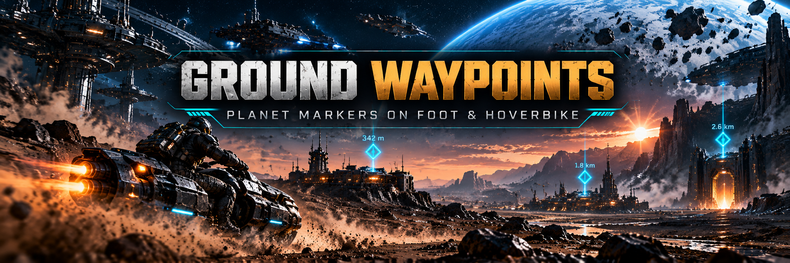

# Ground Waypoints — planet markers on foot and on the hoverbike for SpaceBourne 2

From your ship, SpaceBourne 2 marks a planet's outposts, cities, dungeons and mission sites. Land,
step out or jump on the hoverbike, and those markers vanish: you cross the planet guessing.
Ground Waypoints brings them back on the ground: a marker, the name and the distance, in the same
colours the game uses from the ship.

Version 0.1.0 · UE4SS Lua mod · works alone or with the rest of the
[realism set](#part-of-the-spacebourne-2-realism-set). Idea by **TheCalcMan** (Steam).

## What it does

- **On foot and on the hoverbike**, while you are on a planet's surface:
  - **places**: outposts, cities, villages, camps, wrecks;
  - **locations**: dungeons, caves and mission sites;
  - **points of interest** nearby: crash sites, traders and the like.
- **Same look as the ship's markers.** Orange places, pink mission places, grey cleared dungeons.
  The name sits next to the marker with the distance below, in the game's format (`152m`, `3.4km`).
- **Arrows at the screen edge** for the nearest places behind you or off screen, with their distance.
- **Calm.** At most 12 markers, nearest first (mission places always first). Nothing within 40 m
  (you are there). Points of interest only within 5 km; places and locations up to 600 km (a planet's
  outposts and dungeons are often 100–500 km apart).
- **No double markers.** Mission objectives and the few places the game already shows on the
  hoverbike stay the game's own.
- **Out of the way.** Hidden in the ship, in dungeons and stations, in photo mode, with a menu open,
  and when the game hides its HUD.
- **On by default.** Press **0** (zero) to show or hide the markers.

## Requirements

- SpaceBourne 2 (Steam).
- [UE4SS 3.0.1](https://github.com/UE4SS-RE/RE-UE4SS/releases/tag/v3.0.1). Installing HTR or the
  realism set installer installs it too.

## Install

1. Download `GroundWaypoints-0.1.0.zip` from the
   [releases](https://github.com/hubertdungen/SpaceBourne2-GroundWaypoints/releases).
2. Extract it into the game folder (`...\steamapps\common\SpaceBourne 2\`). It adds
   `SB2\Binaries\Win64\Mods\GroundWaypoints\`; the `enabled.txt` inside turns it on.
3. That's it: land on a planet and step out.

Manual install: copy the `GroundWaypoints` folder from this repository into
`SpaceBourne 2\SB2\Binaries\Win64\Mods\`.

Uninstall: delete `SB2\Binaries\Win64\Mods\GroundWaypoints`. Ground Waypoints never writes to your
saves.

## Controls

| Key | What it does |
|---|---|
| **0** (zero, top row) | Show / hide the markers (a short "Ground Waypoints ON / OFF" note on screen). |

The game binds **0** nowhere (we checked its key presets and every key it reads directly), and no
other mod of the realism set uses it plain (Shift+0 is Ammo Discipline's; plain 0 stays quiet while
Shift is held). Change it or remove it with `ToggleKey` in `scripts\config.lua`.
The game's own keys (F1, F2, F5, F6, F8, F10, F11, F12, I for cargo, P as a second Escape) and Ctrl or
Alt (map and crouch on foot) are refused.

## Settings

Edit `Mods\GroundWaypoints\scripts\config.lua`. Every line is optional.

- `Enabled`: `false` switches the mod off completely.
- `StartOn`: start with the markers shown (`true`) or hidden.
- `ToggleKey`: `"0"` by default; `""` for no key.
- `OnFoot` / `OnHoverbike`: where markers show.
- `Places` / `Locations` / `PointsOfInterest`: what is marked.
- `MaxDistance` (600 000 m), `PoiMaxDistance` (5 000 m), `HideWithinMeters` (40 m).
- `MaxMarkers` (12), `OffscreenArrows` and `MaxOffscreenArrows` (4).
- Look: `MarkerSize`, `TextScale`, `HeightOffset`, `ShowNames`, and `Colors`.

The text follows the game's own **indicator scale** setting, like the ship's markers.

## How it works

The game draws all its markers on the HUD canvas (`Q1Hud`). On foot its planet-place function stops
at once, and on the hoverbike it only draws an active mission's site. There is no switch to flip, so
Ground Waypoints draws the markers itself on the same canvas, with the game's own font, icons and
colours. It reads the places' positions and names a few times a second and keeps only plain data;
each frame it only places and draws the markers. Details: [DESIGN.md](DESIGN.md).

## Status and known limits

Tested in game on 2026-10-31 on planet Oclite (details in [DESIGN.md](DESIGN.md), section 8):
- on foot and on the hoverbike, the markers, names, distances and edge arrows;
- the real 0 key (the game does nothing else with it);
- the game's own markers (your ship) unchanged;
- cost: about 0.25 ms a frame with 2 markers;
- your saves untouched.

Not tested yet: a screen full of markers (up to 12) and the frame time with all of them; it should
stay well under 1 ms a frame.

Known limits:

- **Only what the planet has loaded.** Places appear once the game has created them, as in the
  ship.
- **Point-of-interest names come from the game's internal names** ("Ship Crash", "Raided House"…), so
  they are in English.
- **The first time you step out on a planet after starting the game late in a session** (for example
  after reloading the mod), it may search once for places it missed: about 0.2 s of small stutters.

## Part of the SpaceBourne 2 realism set

Part of the realism set, built around [Hardcore Tactical Realism](https://www.nexusmods.com/spacebourne2/mods/4)
as the core mod. HTR is not required: this mod works on its own or with any of the others.
To install them all at once, use the installer:
[SpaceBourne 2 Realism](https://github.com/hubertdungen/SpaceBourne2-Realism)
([Nexus](https://www.nexusmods.com/spacebourne2/mods/11)).

| Mod | Status |
|---|---|
| **Hardcore Tactical Realism (HTR)** — realistic ballistics and tactical AI | released: [GitHub](https://github.com/hubertdungen/SpaceBourne2-HardcoreTacticalRealism) · [Nexus Mods](https://www.nexusmods.com/spacebourne2/mods/4) · [Steam discussion](https://steamcommunity.com/app/1646850/discussions/0/573805072991123580) |
| **Split Controls** — separate invert for ship and on foot | released: [GitHub](https://github.com/hubertdungen/SpaceBourne2-SplitControls) · [Nexus Mods](https://www.nexusmods.com/spacebourne2/mods/5) |
| **Silent Ops** — realistic stealth | released: [GitHub](https://github.com/hubertdungen/SpaceBourne2-SilentOps) · [Nexus Mods](https://www.nexusmods.com/spacebourne2/mods/6) |
| **Gear Without Levels** — use gear regardless of level | released: [GitHub](https://github.com/hubertdungen/SpaceBourne2-GearWithoutLevels) · [Nexus Mods](https://www.nexusmods.com/spacebourne2/mods/7) |
| **SB2 HOTAS** — HOTAS, triple screens, head tracking | released: [GitHub](https://github.com/hubertdungen/SpaceBourne2-HOTAS) · [Nexus Mods](https://www.nexusmods.com/spacebourne2/mods/8) |
| **Faction Power** — your deeds earn your faction power | released: [GitHub](https://github.com/hubertdungen/SpaceBourne2-FactionPower) · [Nexus Mods](https://www.nexusmods.com/spacebourne2/mods/9) |
| **Tactical Engineering** — realistic deployable turrets | released: [GitHub](https://github.com/hubertdungen/SpaceBourne2-TacticalEngineering) · [Nexus Mods](https://www.nexusmods.com/spacebourne2/mods/10) |
| **Ground Waypoints** — planet markers on foot and on the hoverbike (this mod) | released: [GitHub](https://github.com/hubertdungen/SpaceBourne2-GroundWaypoints) |
| Ammo Discipline, Tactical First Person, Get Out of the Way | coming |

## Thanks

**TheCalcMan** (Steam), for the idea of this mod and for play-testing the realism set.

## License

MIT. See [LICENSE](LICENSE).
